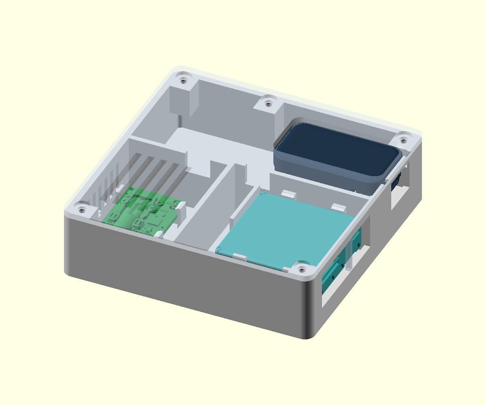
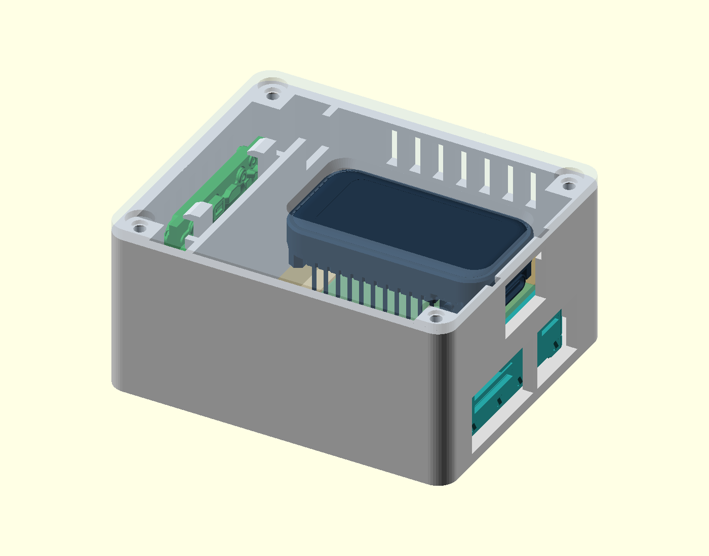
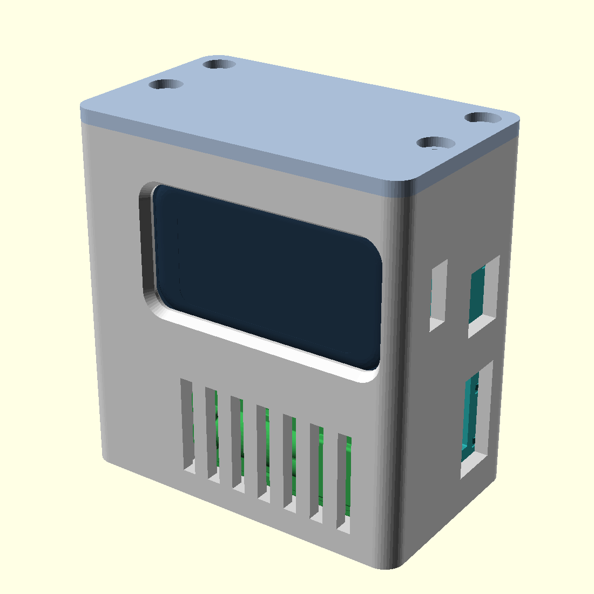
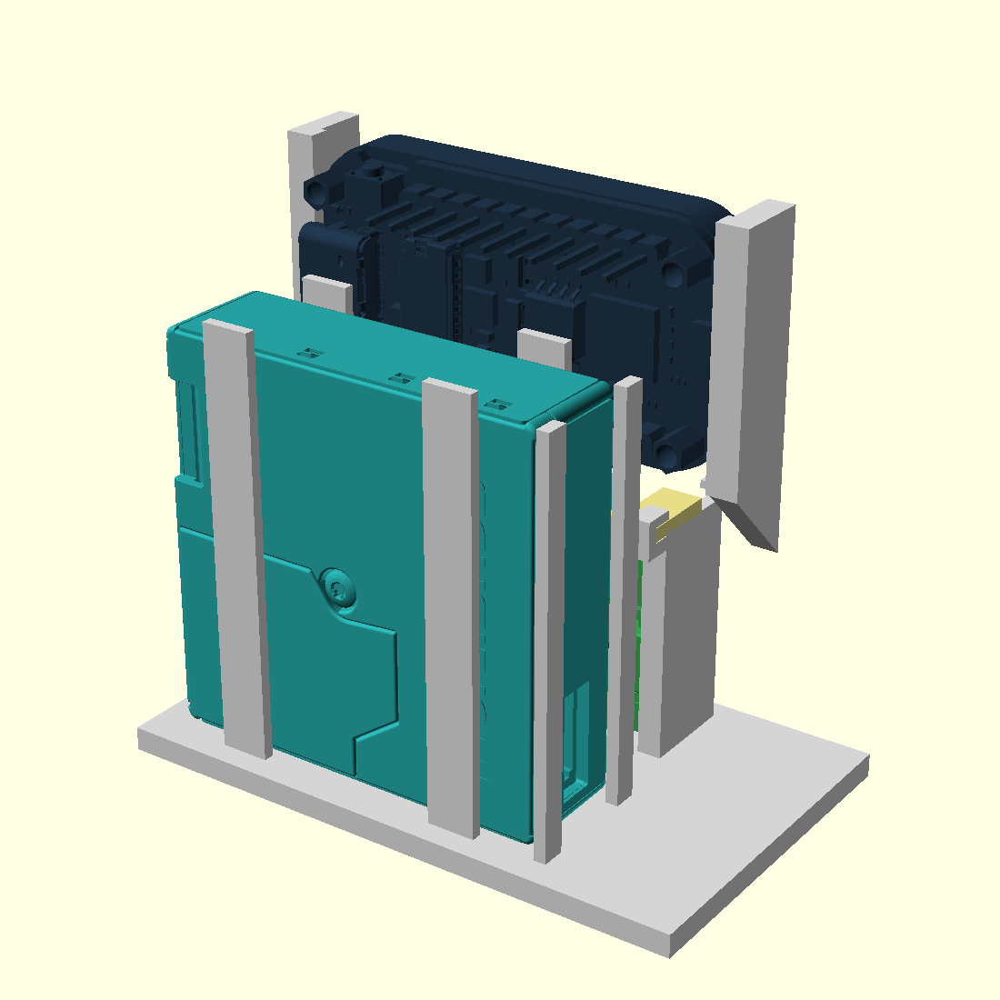
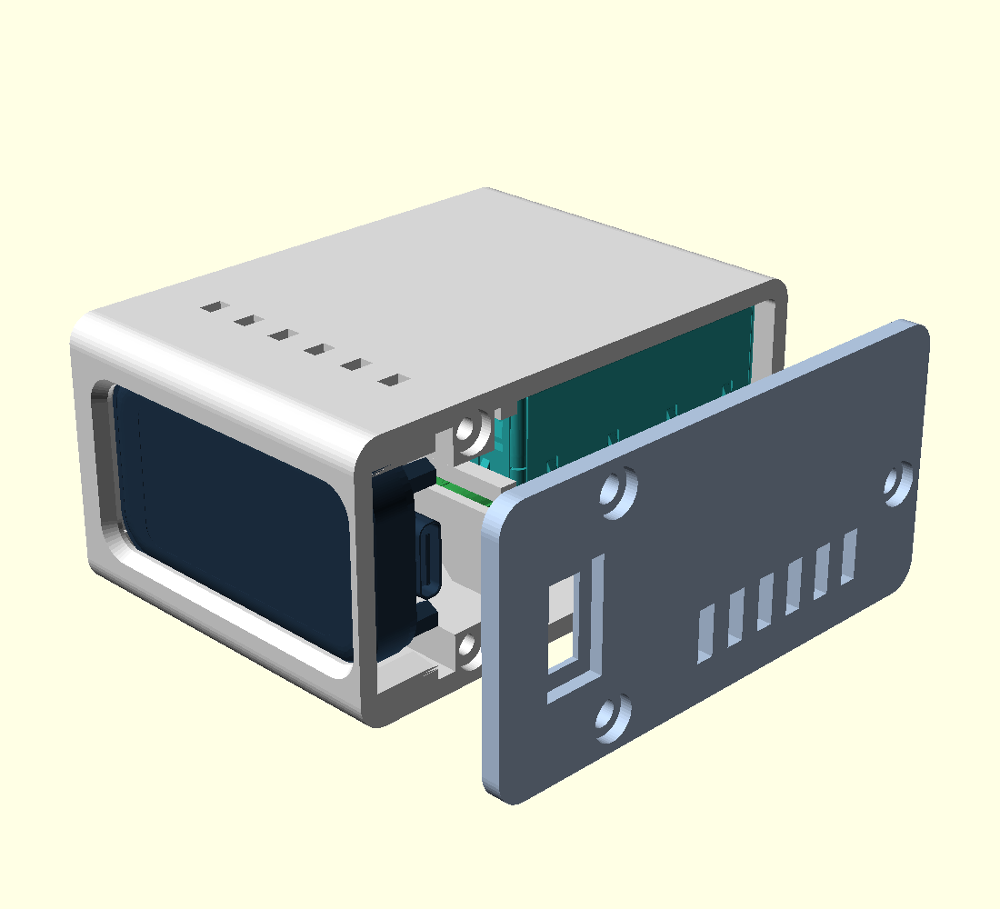
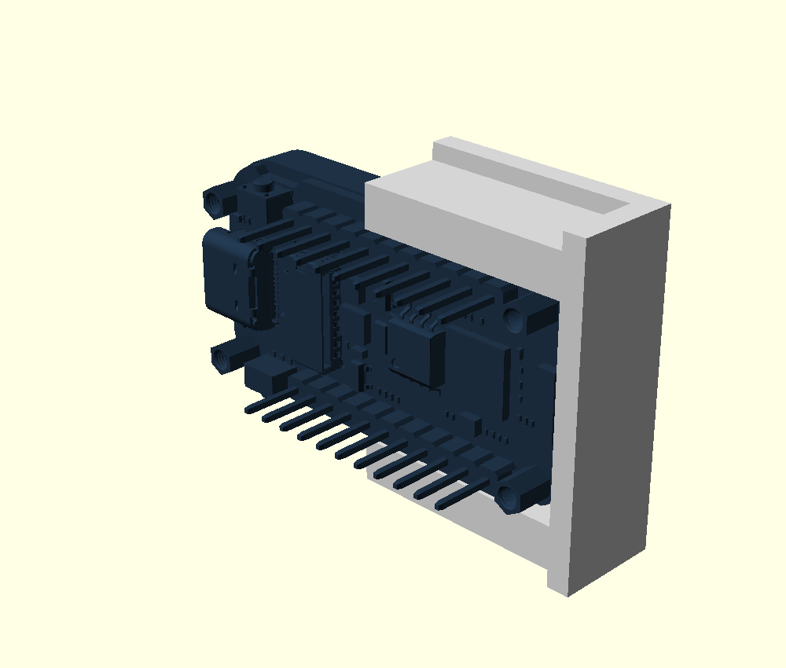
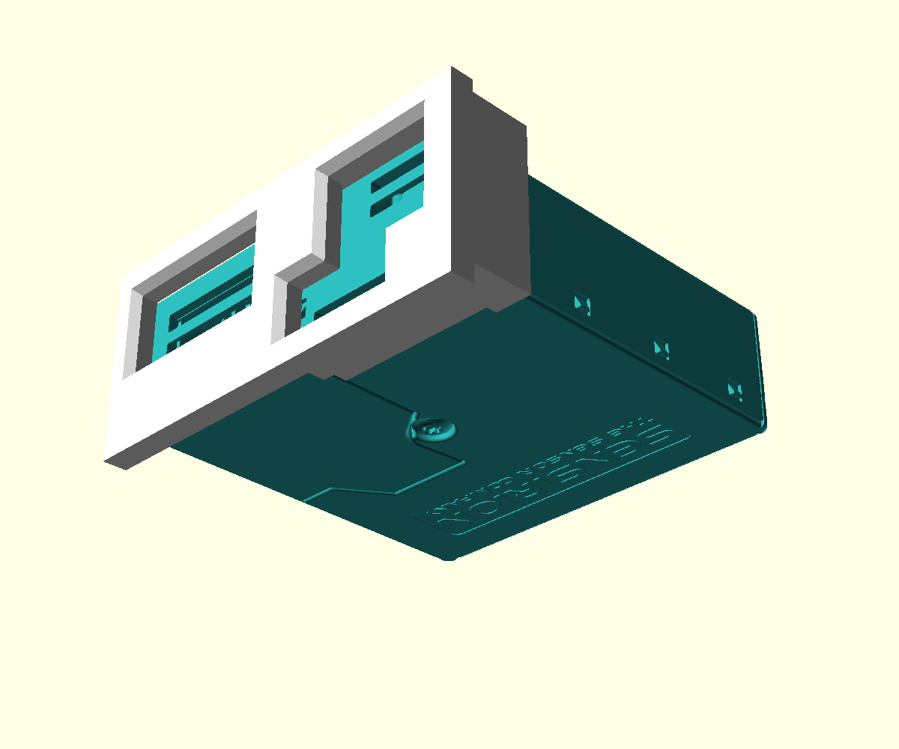
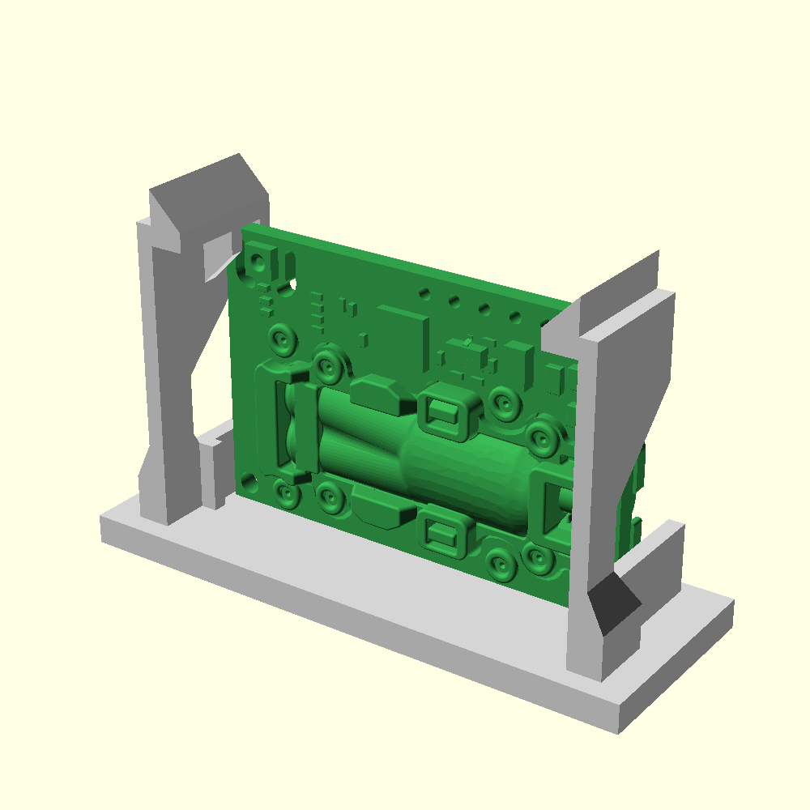
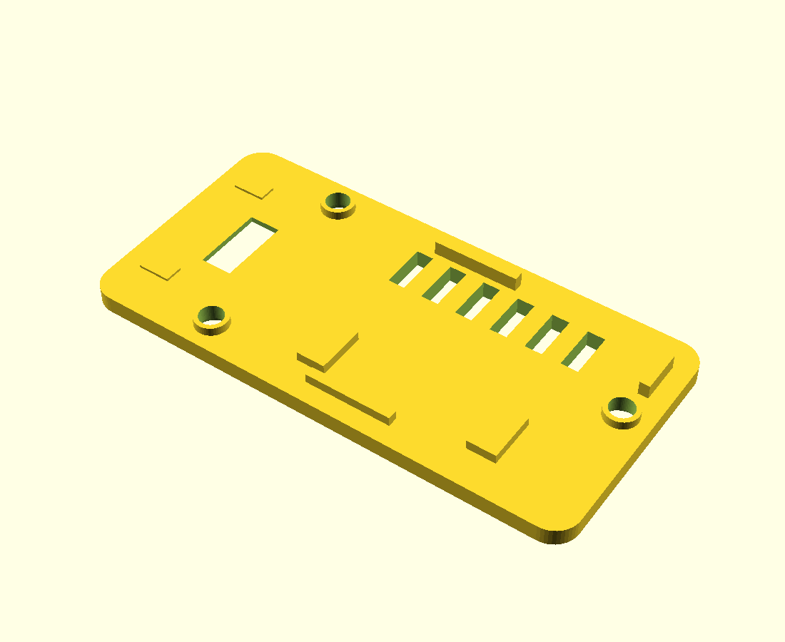
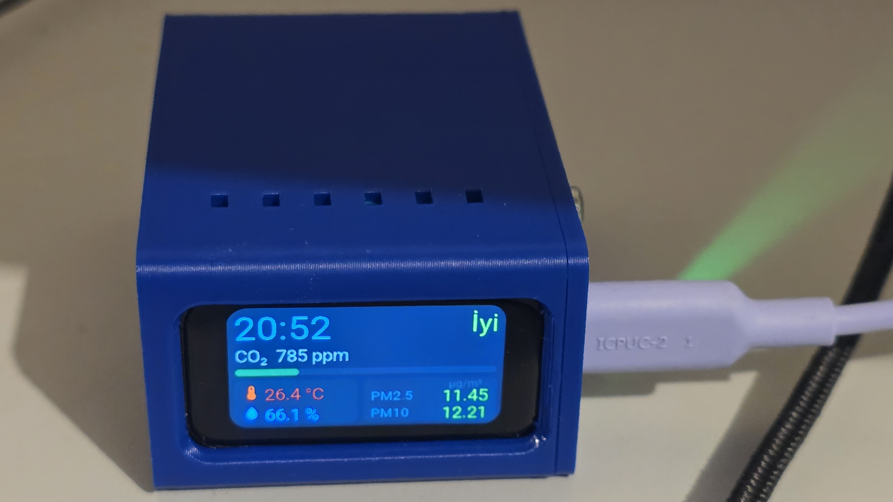

This is finally a hardware post. It is still not the homeserver update, but at least the project has escaped the teaser stage.

I had an air quality sensor assembly built around an ESP32-C6 with a touchscreen, an SPS30 particulate matter sensor, and an SCD30 CO₂ sensor. What I needed was a box. A small box, preferably, with a visible screen, an accessible USB port, and enough openings for the things that are supposed to measure the air.

That sounded like the easy part. Then I tried putting the actual hardware inside it.

## Starting with the models

I used Codex to help generate and revise the enclosure in OpenSCAD. The starting point was the reference models of the boards and sensors, together with the mechanical drawings and sensor design guides. The workflow was mostly screenshots, measurements, generated geometry, and increasingly specific comments about small pieces of plastic.

The requirements grew quickly:

- Keep the touchscreen accessible without hiding its corners behind screw posts.
- Leave room for the ESP32 headers, not just the PCB.
- Make the USB socket usable after the enclosure is closed.
- Mount the sensors securely without pressing on the SCD30 optical assembly.
- Expose both SPS30 inlets and keep its exhaust separate.
- Make the parts printable and the electronics removable.

The initial layout put the components beside each other in a fairly flat enclosure. It was easy to understand in a render and quite generous with internal space. It was also about 100 × 100 mm, which started to feel excessive for three components.

*The earlier layout. Plenty of room, including room I did not particularly want to print.*

## Rotating components was more useful than shrinking walls

Before making every wall thinner, I changed the arrangement. An intermediate version moved the SCD30 onto a side wall and placed the ESP32 above the SPS30.

*The first compact arrangement, still with the screen facing the removable lid.*

Another version placed the SCD30 below the screen and stood the SPS30 behind them. That produced a much smaller footprint, but a taller box.

*The upright version before moving the lid to the side.*

*Removing the walls makes the stacked arrangement easier to see.*

The next change was to move the ESP32 onto what had been a narrow side face, with its USB end pointing toward the lid. In the normal operating position, the SCD30 is in the lower part of the enclosure, the SPS30 sits above it, and the lid opens from the side. The screen's long edge is horizontal in that position.

The side lid also becomes the end stop for the display's sliding mount. I could stop trying to secure the ESP32 with screws hidden behind the screen.

Eventually I added another 5 mm between the ESP32 and the sensors. The reference model includes about 15.6 mm of display, PCB, components, and headers, but a header is not the end of a cable. Somewhere the wire still has to turn.

The current outside dimensions are **68.9 × 50.6 × 33.9 mm**. The extra wiring space was worth keeping, even after spending so much time making the enclosure smaller.

## The screen mount became its own project

The first screen mount used screw positions that intruded into the opening. Besides hiding parts of the screen, the screws would have been awkward to reach behind the assembled display. Sliding rails looked much more practical.

Then the retaining arms were too thin. Their roots needed widening. The opening needed enlarging. The screen sat too deeply, so the front needed a chamfer. The rear support needed to resist touchscreen presses. A retaining lip reached the display package instead of the PCB. Near the USB end, the same idea managed to touch the buttons.

At this point I started making small fit pieces instead of printing the entire enclosure after every change. A single corner was not enough to check the width properly, so that became a U-shaped piece holding two corners. A full-length rail test covered the button clearance and the insertion path.

*The reference board is shown for context. Only the light-colored holder is printed.*

Even the word "height" caused trouble. In one screenshot I marked two distances: the thickness of the retaining lip and the clear space beneath it. The wrong one was enlarged. After that, the dimensions needed names more precise than "make that bit taller."

The current requested rail dimensions are:

| Feature | Dimension |
| --- | --- |
| Side-to-side opening | 25.2 mm |
| Reference glass width | 24.55 mm |
| Nominal clearance per side | 0.325 mm |
| Clear space below the retaining lip | 6.6 mm |
| Retaining lip thickness | 2.2 mm |
| Lip-free section at the USB end | 12 mm |

Those last 12 mm leave the buttons clear. The lid retains the USB end when the enclosure is closed.

## It fits in CAD. Can it get there?

There was a particularly useful failure after the small tests: the ESP32 entered the full enclosure and then stopped.

One revision had a 24.6 mm channel for 24.55 mm glass. That left **0.025 mm per side**. I had effectively designed a demonstration of how little clearance is possible to type into a CAD file.

There was also roughly 0.1 mm of interference at the reference PCB surface. An earlier check sampled model vertices, which missed interference on the flat face. Seeing no sampled vertices inside the enclosure was not enough evidence to call the fit correct.

The checks were changed to sample surface points and examine several positions along the sliding path. Entry chamfers were added too. After trying larger clearances, the requested opening settled at 25.2 mm and the net height at 6.6 mm.

The test pieces now use the main enclosure's rail module directly. That removes another possible mistake: testing one piece of geometry and then accidentally copying a slightly different version into the box.

These checks still only sample the geometry. They do not simulate a continuous insertion, filament expansion, rough surfaces, or a slightly different board revision. The printer and the real board remain part of the process.

## The air needs a route through the box

The SPS30 has two inlets and one outlet. Opening a rectangle near the sensor does not automatically expose all three. One inlet is on the adjacent underside, and an early enclosure revision left that route obstructed.

The revised design gives that second inlet an elbow-shaped path to the outside. A surrounding channel separates the inlet route from the enclosure's internal air, while the outlet has its own opening. The external edges also received 0.8 mm chamfers.

*The underside view was necessary here. The missing route was much easier to overlook from above.*

There is a small assembly gap at the sensor-to-channel interface. Thin closed-cell foam or a suitable silicone gasket is intended to seal that perimeter without covering the ports. The printed channel alone has not been tested for leakage or airflow performance.

### Testing the SCD30 snap-fit mount

The SCD30 raised a different problem. Its mounting clips had to hold the PCB rather than squeeze the optical body. I made a separate test-print part containing the base and the two retaining arms, so the snap-fit could be tried without printing the whole enclosure again.

*The SCD30 fit-test model. Only the gray holder is printed; the green sensor is included in the render to show the fit.*

The tests focused on getting the PCB into the clips, retaining it from the front, and leaving the connector accessible. One inner jaw reached the connector, so only that jaw was removed; its opposite was kept. The revised arrangement was then applied to the main enclosure.

The resulting SCD30 snap-fit arrangement is still awkward to assemble and remove. It works for now, but I would revisit this mounting method in another version rather than call it a convenient finished solution.

Later, the SCD30 was still too far inside the enclosure to mount comfortably. It moved **17 mm toward the side lid**, leaving about 5.8 mm between its near edge and the lid's inner face. Its main ventilation is now through the lid.

The space behind it became a closed, hollow riser. Internal ribs divide it into smaller cells so the roof does not require one long bridge. That reduces the connected air volume behind the sensor without turning the entire riser into a solid lump of plastic.

This belongs in the model. Changing the slicer's infill percentage changes the inside of a printed solid; it does not close an empty region of the enclosure.

## Screws do not center a lid

The lid could be screwed on and still move sideways before tightening. It needed locating features of its own.

The current lid has edge stops and three small collars around the screw holes. Those collars fit matching recesses in the body, with a nominal 0.25 mm radial allowance. The locators establish the position; the screws hold the lid down.

Moving the SCD30 toward the lid also brought a clip close to a screw boss. Its support had to be rerouted so it would not merge into the boss and become a very convincingly non-flexible snap fit. Every convenient empty space already seemed to have a job.

## The printed result

There are printable body and lid files, a parameterized OpenSCAD source, and several smaller fit pieces. Some earlier revisions were physically printed, and the failed fits provided much better information than another reassuring render.

The project has now made it into a printed blue enclosure, with the display running and the USB cable connected from the side. The final design is not especially convenient to use or service, particularly around the SCD30 snap-fit mount, but it does the job for now.

*The actual box, after all those renders and fit tests. The screen is accessible, the USB cable is connected, and the hardware is finally inside an enclosure.*

This shows the assembled device running; it does not establish the performance of every internal revision. The SPS30 inlet seal and airflow still need verification, and I have not established how the enclosure affects measurement response or temperature bias.

Codex was useful for producing geometry, making repeated changes, and creating small test parts quickly. It also confidently helped produce a rail with almost no clearance. The productive workflow turned out to be a loop: describe, generate, inspect, print a small piece, and measure what actually happened.

At least this time, the last picture is a working device instead of another render.
